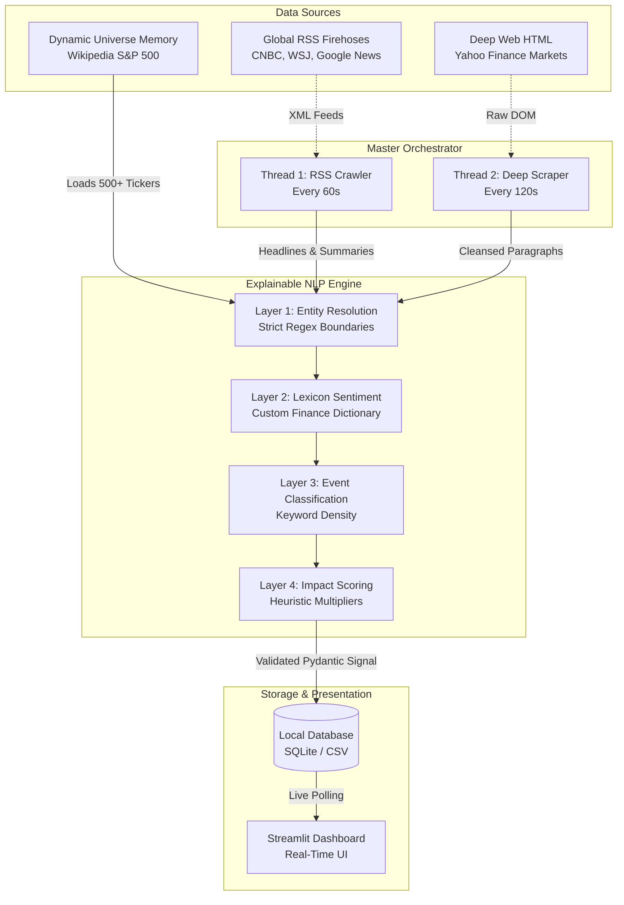

# 🏗️ Risk Engine System Architecture

This document outlines the end-to-end architecture of the **Production-Grade Live Risk Engine**. The system is designed to be highly scalable, completely free to operate (no API keys required), and processes global financial data concurrently using a dual-pipeline architecture.

## 📊 High-Level Architecture Diagram

---

## 1. Dynamic Universe Configuration (`config.py`)
At boot, the system dynamically configures its operational memory.
* **Mechanism:** It uses `pandas` and `requests` to scrape the live Wikipedia page for the **S&P 500**.
* **Output:** A massive, dynamically generated Python dictionary containing 503 tickers and their common aliases (e.g., `AAPL` -> `["Apple", "AAPL"]`). This ensures the engine tracks the entire market, not just a hardcoded subset.

## 2. The Master Orchestrator (`scripts/live_risk_daemon.py`)
This is the heart of the execution loop. It acts as a multi-threaded daemon orchestrating two parallel data pipelines:

* **Pipeline A: The Fast RSS Firehose (Thread 1)**
  * Connects to Public RSS Firehoses (CNBC, WSJ, Google News Global).
  * Executes every 60 seconds to provide ultra-low latency signals.
  * Legally bypasses bot protections and paywalls because RSS feeds are designed for machine consumption.

* **Pipeline B: The Deep HTML Scraper (Thread 2)**
  * Manually connects to deep web sources like Yahoo Finance using `requests` and custom headers.
  * Executes every 120 seconds.
  * Uses `BeautifulSoup` to physically destroy noisy HTML tags (`<script>`, `<style>`, `<nav>`), extracting clean text paragraphs that standard RSS feeds miss.

## 3. The Explainable NLP Engine (`scripts/custom_nlp_engine.py`)
Both pipelines instantly route their text into the local NLP pipeline. This pipeline replaces slow, expensive black-box LLMs with a blazing-fast, **Explainable AI (XAI)** architecture.
* **Layer 0 (Preprocessing):** Regex strips URLs and normalizes text.
* **Layer 1 (Named Entity Resolution):** The engine scans the text against the 503 S&P 500 aliases. If a company is mentioned, it proceeds; otherwise, it is discarded as noise.
* **Layer 2 (Sentiment):** **VADER** analyzes the sentiment. We injected a custom *Financial Lexicon* (e.g., "slashed" = highly negative) so it understands Wall Street jargon.
* **Layer 3 (Zero-Shot Classification):** Keyword-density algorithms categorize the event (e.g., *Macroeconomic*, *Geopolitical*) and calculate a mathematical **Confidence Score**.
* **Layer 4 (Impact Scoring):** A heuristic formula calculates severity from 1 to 10 based on sentiment extremity and multiplier keywords.

## 4. Storage & State (`store/db.py`)
Data integrity is maintained using strict schema validation.
* **Mechanism:** All data passing through the NLP engine is strictly validated using `pydantic` schemas before being committed.
* **Storage:** Validated signals are stored in a local SQLite database (`data/signals.db`). Writing locally takes fractions of a millisecond, allowing the daemon to process thousands of articles instantly.

## 5. The Real-Time Dashboard (`app.py`)
The presentation layer is built with **Streamlit** and **Plotly**.
* **Live Refresh:** The UI reads directly from the SQLite database. As the background daemon adds new rows, the user simply clicks "Rerun" to see live data populate the charts.
* **Dynamic Filters:** The UI dynamically pulls the 503 tickers from `config.py` to populate its sidebar, ensuring the dashboard matches the engine's memory.
