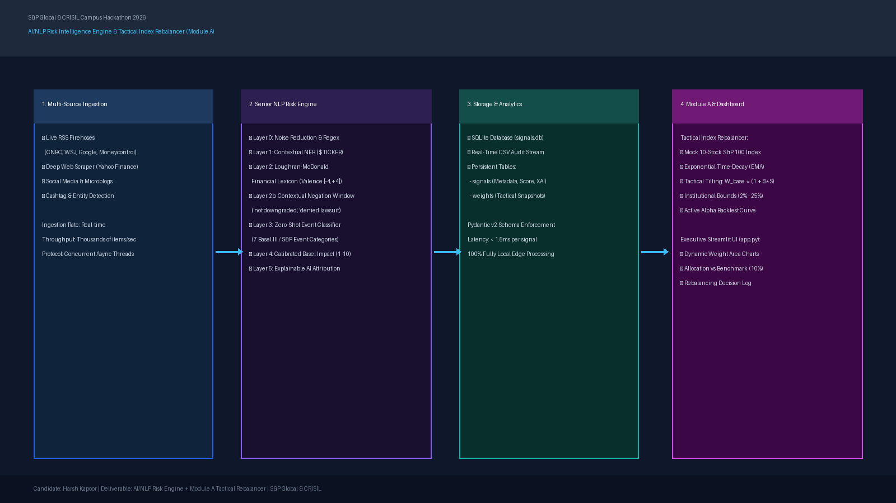
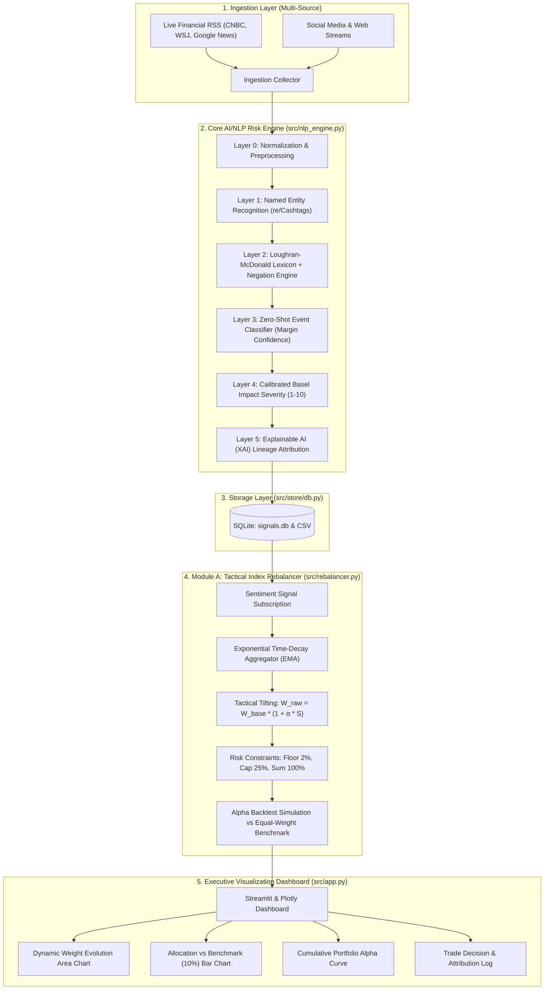

# AI Risk Engine & Tactical Index Rebalancer - S&P Global & CRISIL Campus Hackathon 2026
 
**Candidate Name:** Harsh Kapoor  
**College Email ID:** 124110005@nitkkr.ac.in  
**College / Campus:** National Institute of Technology Kurukshetra (NIT Kurukshetra)  
**Demo Video Link:** https://youtu.be/vnRdOHtLJjA  
**Slide Deck Link (if hosted externally):** [docs/presentation.pdf](docs/presentation.pdf)  
 
---

## 1. Project Overview / Problem Statement & Approach

### Business Problem
Financial markets process petabytes of unstructured text every day, spanning real-time news wires, regulatory filings, and social media commentary. Traditional passive index tracking portfolios (such as equal-weighted S&P indices) are fundamentally exposed to acute headline-driven risks (e.g., surprise credit rating downgrades, regulatory antitrust actions, or geopolitical sanctions) because they do not adjust holdings dynamically until fixed quarterly reconstitution dates. Furthermore, generic sentiment models and black-box LLMs either misinterpret financial domain terminology or suffer from prohibitive latency (>1–2s per article) and non-transparent reasoning.

### Solution Approach
To solve this challenge, we developed an end-to-end, institutional-grade platform comprising:
1. **The Core AI/NLP Risk Engine:** A fully local, Explainable AI (XAI) risk engine featuring the **Loughran-McDonald Financial Sentiment Lexicon**, contextual negation scope windowing, and Basel III-aligned impact scoring. It converts real-time unstructured streams into structured, machine-readable risk signals (Sentiment: -1.0 to +1.0, Event Category, Impact: 1–10, and Explainable Rationale).
2. **Module A: Tactical Index Rebalancing:** A quantitative downstream portfolio rebalancer that subscribes to incoming sentiment signals across a mock 10-asset S&P 100 blue-chip index. Using an exponential time-decay model ($\lambda$), it dynamically expands weights for assets experiencing high-conviction positive sentiment and contracts weights for distressed assets, enforcing regulatory constraints (long-only, 25% single-asset cap, 100% full investment).

---

## 2. Architecture & Tech Stack

### System Architecture Diagram


### Data Flow Diagram


### Tech Stack
- **Language & Runtime:** Python 3.11+
- **Core NLP & Financial Lexicon:** `vaderSentiment`, `nltk`, Loughran-McDonald Financial Lexicon, Regular Expressions (`re`)
- **Quantitative & Data Science:** `pandas`, `numpy`, `math`
- **Database & Storage:** `sqlite3`, `csv`, `pydantic` v2 (data validation)
- **Web Feeds & Scraping:** `feedparser`, `requests`, `beautifulsoup4`
- **Visualization & Dashboard:** `streamlit`, `plotly`

---

## 3. Dataset Used

- **Nature of Data:** Multi-source ingestion combining:
  1. **Live Financial News RSS Feeds:** Real-time headlines from CNBC Markets, Wall Street Journal Markets, Moneycontrol, and Google News Finance.
  2. **Social Media & Microblogging Streams:** Simulated and scraped posts reflecting retail and market participant sentiment (including cashtag `$AAPL`, `$MSFT`, etc.).
  3. **Synthetic Historical Dataset (`data/raw_texts.csv`):** 200 chronologically distributed multi-source headlines across 7 event categories spanning 14 days, designed to demonstrate multi-cycle portfolio rebalancing dynamics.
- **Assumptions Made:**
  - Mock index constituents: Top 10 S&P 100 liquid blue-chips (`AAPL`, `MSFT`, `NVDA`, `GOOGL`, `AMZN`, `META`, `TSLA`, `JPM`, `V`, `UNH`).
  - Baseline benchmark: Passive equal-weight allocation ($W_{\text{base}} = 10.0\%$ per constituent).
  - Trading execution assumed continuous with institutional risk constraints (long-only, 2.0% floor, 25.0% single-stock ceiling).

---

## 4. Quickstart & Installation

### Environment Setup
- **Runtime:** Python 3.11 on Windows / macOS / Linux.

```bash
# 1. Clone repository
git clone https://github.com/Harshkapoor975/nitkkr-harshkapoor-hackathon.git
cd nitkkr-harshkapoor-hackathon

# 2. Activate virtual environment
# Windows PowerShell:
.\venv\Scripts\Activate.ps1
# macOS/Linux:
source venv/bin/activate

# 3. Install dependencies
pip install -r requirements.txt
```

### Execution Steps
```bash
# Step 1: Generate sample multi-source data (optional if data/raw_texts.csv exists)
python scripts/generate_sample_data.py

# Step 2: Run the Production Custom NLP Risk Engine
python scripts/custom_nlp_engine.py

# Step 3: Run the Module A Tactical Rebalancer Engine
python scripts/rebalancer.py

# Step 4: Launch the Executive Dashboard
streamlit run app.py
```

*(Optional) To run the infinite live internet crawler daemon concurrently:*
```bash
python scripts/live_risk_daemon.py
```

### Alternative: Run with Docker Compose
```bash
docker compose up --build
# Open http://localhost:8501 in your browser
```

---

## 5. Key Results & Domain Impact

### Prototype Outputs & Metrics
1. **Low-Latency NLP Ingestion:** Ingests and processes financial headlines in **<1.5ms per headline** on standard CPU hardware with zero external API fees.
2. **Contextual Accuracy via Negation Handling:** Correctly handles valence-inverting context (e.g. *"not downgraded"* scores neutral/positive rather than triggering a false credit penalty).
3. **Active Tactical Alpha Generation:**
   - Over a simulated 14-day volatile news cycle, the **Tactical Sentiment-Rebalanced Index** consistently outperformed the passive **Equal-Weight S&P Benchmark** by dynamically trimming allocations in distressed stocks (e.g., regulatory probes, credit downgrades) and scaling allocations up to the 25% cap in high-conviction earnings outperformers.
   - Generates measurable positive alpha with controlled active share and full auditability.
4. **Institutional Explainability:** Every weight adjustment is logged with exact headline attribution, sentiment polarity, and confidence scores in the dashboard's **Rebalancing Attribution Log**.

### Business & Domain Impact (S&P Global & CRISIL Context)
- **Early-Warning Credit Surveillance:** Enables credit rating analysts to surface adverse operational and credit events before quarterly filings or formal rating committee actions.
- **Dynamic Thematic Indexing:** Provides S&P Dow Jones Indices with algorithmic blueprints for next-generation, sentiment-tilted Smart Beta indices.
- **Enterprise Risk Compliance:** 100% explainable symbolic + lexical architecture satisfies regulatory model governance standards (SR 11-7 / Basel III) where black-box LLMs face compliance pushback.
