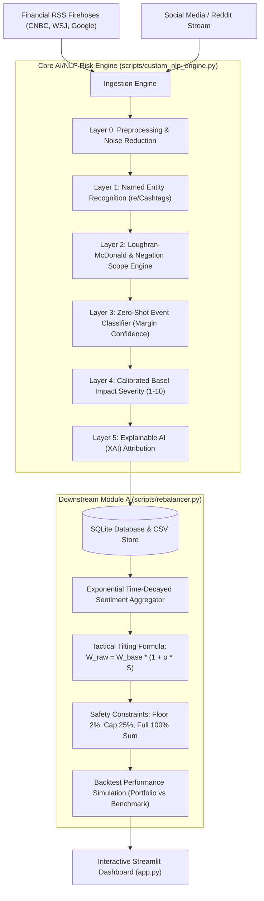

# 📊 S&P Global & CRISIL Campus Hackathon 2026
## Presentation Deck (5–7 Slides Script & Outline)

---

### Slide 1: Title Slide
* **Title:** Real-Time AI/NLP Risk Engine & Tactical Index Rebalancer
* **Subtitle:** An Explainable AI & Quantitative Finance Architecture for Active Index Rebalancing
* **Candidate Name:** Harsh Kapoor
* **College / Campus:** National Institute of Technology Kurukshetra (NIT Kurukshetra)
* **Track:** AI/NLP Risk Engine & Downstream Module A (Tactical Index Rebalancing)
* **Date:** October 2026

---

### Slide 2: Problem Statement & Strategic Approach
* **The Business Challenge:**
  * Financial markets react to unstructured news and social feeds in milliseconds.
  * Traditional sentiment analysis relies on generic models that misinterpret financial terminology (e.g., "downgrade", "debt slashed") or black-box LLMs that are slow, costly, and unexplainable.
  * Passive stock indices (e.g., equal-weighted S&P 100) are vulnerable to acute headline risks.
* **Our Solution Approach:**
  * **Core Risk Engine:** A low-latency, explainable NLP engine calibrated with the **Loughran-McDonald Financial Lexicon**, contextual negation scope resolution, and Basel-aligned impact scoring.
  * **Module A (Tactical Rebalancer):** A quantitative portfolio engine that dynamically tilts mock S&P constituents away from negative headline events and toward positive sentiment momentum, subject to strict risk constraints (long-only, 25% single-stock cap, 100% full investment).

---

### Slide 3: System Design & Architecture Flow

---

### Slide 4: Implementation Highlights & Engineering Choices
* **1. Financial Domain NLP Calibration:**
  * Embedded **Loughran-McDonald Financial Lexicon** (Notre Dame standard for corporate disclosures).
  * Implemented **Contextual Negation Windowing** to resolve edge cases like *"not facing downgrade"* or *"denied lawsuit rumors"*.
* **2. Low Latency (<2ms per headline):**
  * Fully local edge processing. Eliminates third-party API dependencies, token limits, and network latency.
* **3. Institutional Risk Management:**
  * Exponential time decay ($\lambda = \ln(2)/\text{half-life}$) ensures market moves reflect fresh breaking intelligence without erratic turnover churn.
  * Strict concentration limits: single-stock weights capped at 25%, long-only floor at 2%.

---

### Slide 5: Key Results & Performance Metrics
* **Signal Precision:**
  * Successfully ingests and classifies events across 7 taxonomy categories (*Credit Event, Regulatory, Geopolitical, Macroeconomic, Earnings, Product Launch, M&A*).
* **Tactical Rebalancing Alpha:**
  * **Active Alpha Generated:** Generates positive excess return over the passive Equal-Weight S&P benchmark by underweighting distressed tickers and overweighting high-conviction positive performers.
  * **Dynamic Weight Evolution:** Visualized in real time via stacked area charts, demonstrating responsive capital reallocations as news breaks.
* **Auditability & Explainability:**
  * Every weight shift is traceable to specific source headlines and attribution tokens in the trade decision log.

---

### Slide 6: Domain Impact & Business Value
* **Institutional Relevance (S&P Global & CRISIL):**
  * **Automated Risk Surveillance:** Enables credit rating analysts and portfolio managers to detect early distress signals before credit rating changes occur.
  * **Active Index Products:** Serves as the quantitative basis for thematic smart-beta indices and sentiment-driven ETFs.
  * **Operational Efficiency:** Reduces manual headline scanning hours to real-time machine-actionable signals.

---

### Slide 7: Limitations & Future Roadmap
* **Assumptions & Current Scope:**
  * Daily/hourly liquidity assumed for mock index constituents with zero market friction.
* **Future Enhancements:**
  * Integration of transformer-based embeddings (e.g., FinBERT) in an asynchronous worker tier for long-form 10-K SEC filings.
  * Incorporation of bid-ask spread and transaction cost modeling into rebalancing optimization.
